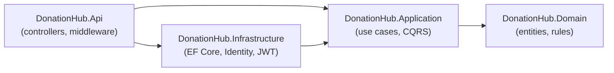
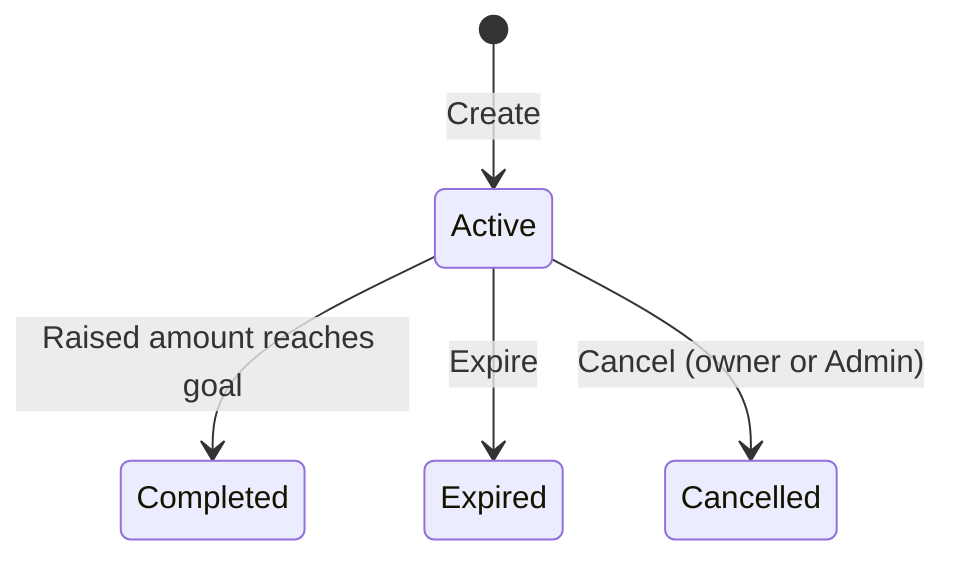

<div align="center">

# DonationHub

### A Secure, Bilingual Donation & Campaign Management Backend

A modular RESTful API built with **ASP.NET Core 10**, **Clean Architecture**, and **CQRS** for managing charitable campaigns, categories, and users, with a payment-ready domain model.

[](https://dotnet.microsoft.com/)
[](https://learn.microsoft.com/dotnet/csharp/)
[](https://learn.microsoft.com/aspnet/core/)
[](https://learn.microsoft.com/ef/core/)
[](https://www.microsoft.com/sql-server)
[](https://xunit.net/)
[](#project-status--roadmap)

</div>

---

## Table of Contents

- [Overview](#overview)
- [Key Features](#key-features)
- [Architecture](#architecture)
- [Domain Model](#domain-model)
- [Technology Stack](#technology-stack)
- [Getting Started](#getting-started)
- [Configuration Reference](#configuration-reference)
- [Seeded Data & Roles](#seeded-data--roles)
- [API Reference](#api-reference)
- [Authentication Flow](#authentication-flow)
- [Error Handling](#error-handling)
- [Testing](#testing)
- [Project Status & Roadmap](#project-status--roadmap)
- [Contributing](#contributing)
- [License](#license)

---

## Overview

**DonationHub** is the backend of a charitable donation platform. Administrators publish fundraising **campaigns** grouped into **categories**; the public can browse active campaigns and completed "success stories" in **Arabic or English**; and registered users authenticate with short-lived JWT access tokens and rotating refresh tokens.

The solution is organized as four layered projects (Domain, Application, Infrastructure, API) plus a dedicated test project for each, keeping business rules independent from persistence and HTTP concerns.

> **Project status:** Under active development. Authentication, user management, categories, and campaigns are implemented. The payment and donation workflow has its domain model and database schema in place but is not yet exposed through the API (see the [roadmap](#project-status--roadmap)).

---

## Key Features

### Authentication & Identity
- User registration and login built on **ASP.NET Core Identity** (unique email enforced).
- **JWT access tokens** (HMAC-SHA256) with a configurable lifetime and zero clock skew.
- **Refresh tokens** generated from 64 cryptographically secure random bytes; only a **SHA-256 hash** is stored.
- **Refresh-token rotation with reuse detection**: each refresh revokes the old token and links it to its replacement; presenting an already-revoked token revokes the entire token *family*.
- Authenticated profile endpoint (`AuthMe`), profile update, and password change.
- Deactivated accounts are blocked at login.
- Strong password policy (min. 8 characters, upper- and lowercase letters, a digit, and a special character).
- Role-based authorization with three roles: `Admin`, `CampaignManager`, `Donor`.

### Campaign Management
- Create, read, update, delete (soft), and cancel campaigns.
- **Bilingual content** (Arabic and English titles and descriptions), served according to the `Accept-Language` header.
- Public listing of **active** campaigns and a **success-stories** endpoint listing **completed** campaigns.
- Calculated `ProgressPrecent` (capped at 100) and `DaysLeft` (never negative) on every campaign.
- **Optimistic concurrency** via a SQL Server `rowversion` column, so conflicting edits return `409 Conflict`.
- Cancellation restricted to the campaign owner or an Admin.
- Business rules enforced in the domain: only active campaigns can be edited, the goal can never drop below the amount already raised, and end dates must be in the future.

### Category Management
- Public category reading; **Admin-only** create, update, and delete.
- Bilingual names and descriptions; unique names (per language) among non-deleted categories.
- Five categories seeded automatically: Health (الصحة), Education (التعليم), Relief (الإغاثة), Orphans (الأيتام), Environment (البيئة).
- A category that still has campaigns cannot be deleted.

### Administration
- Admins can create staff accounts (`Admin` or `CampaignManager` roles).

### Engineering Foundations
- **CQRS** with MediatR; one folder per feature (command/query, handler, validator).
- **FluentValidation** pipeline behavior that validates every request before its handler runs.
- **Result pattern** (`Result` / `Result<T>`) with typed domain errors instead of exceptions for business failures.
- Consistent **RFC 7807 ProblemDetails** error responses with machine-readable error codes.
- Global exception handler with trace IDs.
- **Soft delete** through an EF Core `SaveChanges` interceptor and global query filters.
- **Repository + Unit of Work** and a **Specification** pattern for queries with includes.
- Strongly typed, validated-on-startup configuration (`ValidateOnStart`).
- Interactive API documentation with **OpenAPI** and **Scalar**, including JWT Bearer authorization.
- Automatic database migration and seeding in the Development environment.

---

## Architecture

DonationHub follows **Clean Architecture**. Dependencies point inward: the Domain depends on nothing.



| Project | Responsibility |
| --- | --- |
| `DonationHub.Domain` | Entities, value objects (`Money`, `Title`, `Description`, `Name`), enums, the `Result` type, and typed domain errors. No external dependencies. |
| `DonationHub.Application` | MediatR commands/queries and handlers, FluentValidation validators, DTOs, options classes, specifications, and the interfaces (repositories, identity, token service) implemented by Infrastructure. |
| `DonationHub.Infrastructure` | EF Core `DbContext`, entity configurations, migrations, repositories, Unit of Work, ASP.NET Core Identity, JWT/refresh-token services, soft-delete interceptor, and data seeders. |
| `DonationHub.Api` | HTTP controllers, global exception handler, OpenAPI/Scalar setup, startup composition, and configuration files. |

### Repository Structure

```text
DonationHub/
├── DonationHub.Api/                    # HTTP layer
│   ├── Controllers/                    # Authentication, Campaigns, Categories, Admin (+ BaseController)
│   ├── Exceptions/                     # GlobalExceptionHandler
│   ├── Extension/                      # Database initialization helper
│   ├── Properties/launchSettings.json
│   ├── appsettings.json
│   └── Program.cs
├── DonationHub.Application/            # Use cases
│   ├── Common/Options/                 # JwtOptions, DonationOptions, Seed*Options
│   ├── DependcyInjection/
│   ├── Dtos/
│   ├── Features/
│   │   ├── Admin/CreateStaff/
│   │   ├── Authentication/             # Register, Login, RefreshToken, GetUser, UpdateProfile, ChangePassword
│   │   ├── Campaigns/                  # Create, Update, Delete, Cancel, GetAll, GetById, GetAllSuccess
│   │   └── Categories/                 # Create, Update, Delete, GetAll, GetById
│   ├── Interfaces/                     # Repositories, Services, IUnitOfWork, IDonationDbContext
│   ├── Specifications/
│   └── Validators/                     # ValidationBehavior (MediatR pipeline)
├── DonationHub.Domain/
│   ├── Common/                         # Errors/ and Results/
│   ├── Entities/                       # Campaign, Category, Donation, RefreshToken, PaymentAttempt, ...
│   ├── Enums/
│   ├── Interfaces/                     # IAduitable, ISoftDeletable
│   └── ValueObjects/
├── DonationHub.Infrastructure/
│   ├── Data/
│   │   ├── AppDBContext/               # DonationDBContext
│   │   ├── Configurations/             # EF Core entity configurations
│   │   ├── Entities/                   # ApplicationUser
│   │   ├── Interceptors/               # SoftDeletableInterceptor
│   │   ├── Migrations/
│   │   ├── Repositories/
│   │   ├── Seeders/                    # DataSeeder (categories), IdentitySeeder (roles, users)
│   │   └── Specifications/
│   ├── DependencyInjection/
│   └── Services/                       # IdentityService, TokenService
├── DonationHub.Domain.Tests/
├── DonationHub.Application.Tests/
├── DonationHub.Api.Tests/
├── DonationHub.Infrastructure.Tests/
└── DonationHub.slnx
```

---

## Domain Model

| Entity | Purpose |
| --- | --- |
| `Campaign` | A fundraising campaign: bilingual title/description, goal and raised `Money`, end date, banner file name, status, category, owner, soft-delete flags, and a `RowVersion` concurrency token. |
| `Category` | A bilingual campaign category with soft delete. |
| `Donation` | A donation to a campaign (amount, status, receipt info). *Domain model only; not yet exposed through the API.* |
| `PaymentAttempt` | A Stripe checkout/payment-intent attempt tied to a donation. *Domain model only.* |
| `ProcessedStripeEvent` | Records processed Stripe webhook events for idempotent handling. *Domain model only.* |
| `IdempotencyRecord` | Stores request hashes and responses for idempotent requests. *Domain model only.* |
| `RefreshToken` | Hashed refresh token with expiry, revocation, token family, and replacement link. |
| `ApplicationUser` | ASP.NET Core Identity user with full name, preferred language (`en` or `ar`), and active flag. |

**Value objects:** `Money` (amount and currency), `Title`, `Description`, and `Name` (each holding Arabic and English values). They are persisted as owned types.

**Campaign lifecycle**



Only `Active` campaigns can be edited, and `Completed`, `Expired`, and `Cancelled` campaigns cannot be cancelled. Other enums: `DonationStatus` (`Pending`, `Succedded`, `Failed`) and `PaymentAttemptStatus` (`Created`, `Succedded`, `Failed`, `Expired`).

---

## Technology Stack

| Technology | Purpose |
| --- | --- |
| C# / .NET 10 | Main development platform |
| ASP.NET Core Web API | HTTP API |
| Entity Framework Core 10 | ORM, migrations, and data access |
| SQL Server | Relational database |
| ASP.NET Core Identity | User and role management |
| JWT Bearer (`Microsoft.AspNetCore.Authentication.JwtBearer`) | API authentication |
| MediatR 14 | CQRS request/handler dispatching and pipeline behaviors |
| FluentValidation 12 | Request validation |
| OpenAPI + Scalar | API specification and interactive documentation |
| xUnit, FluentAssertions, Moq, Coverlet | Unit testing and coverage collection |

---

## Getting Started

### Prerequisites

- [.NET 10 SDK](https://dotnet.microsoft.com/download/dotnet/10.0)
- [SQL Server](https://www.microsoft.com/sql-server) (LocalDB, Express, a full instance, or Docker)
- [Git](https://git-scm.com/)
- An IDE such as [Visual Studio](https://visualstudio.microsoft.com/), [VS Code](https://code.visualstudio.com/), or [JetBrains Rider](https://www.jetbrains.com/rider/)
- *(Optional)* the EF Core CLI: `dotnet tool install --global dotnet-ef`

```bash
dotnet --version   # should print 10.x
```

> **No local SQL Server?** You can run one in Docker:
> ```bash
> docker run -e "ACCEPT_EULA=Y" -e "MSSQL_SA_PASSWORD=<YourStrong!Passw0rd>" \
>   -p 1433:1433 --name donationhub-sql -d mcr.microsoft.com/mssql/server:2022-latest
> ```

### 1. Clone the repository

```bash
git clone https://github.com/ziadtaher8545/DonationHub.git
cd DonationHub
```

### 2. Configure secrets

The API validates its configuration **on startup** and will not start if a required section is missing. Secrets must never be committed, so use **User Secrets** (development) or environment variables.

```bash
cd DonationHub.Api
dotnet user-secrets init
```

Create a `secrets.json` file **outside the repository** with your own values:

```json
{
  "ConnectionStrings": {
    "DefaultConnection": "Server=localhost;Database=DonationHubDb;Trusted_Connection=True;TrustServerCertificate=True"
  },
  "JwtOptions": {
    "SecretKey": "<random secret, at least 32 characters>",
    "Issuer": "DonationHub",
    "Audience": "DonationHub.Clients",
    "ExpiryMinutes": 15,
    "RefreshTokenExpiryDays": 7
  },
  "SeedAdminOptions": {
    "Email": "admin@example.com",
    "Password": "<strong password>",
    "FullName": "Admin User"
  },
  "SeedManagerOptions": {
    "Email": "manager@example.com",
    "Password": "<strong password>",
    "FullName": "Campaign Manager"
  },
  "SeedDonorOptions": {
    "Email": "donor@example.com",
    "Password": "<strong password>",
    "FullName": "Demo Donor"
  }
}
```

Then import it into User Secrets:

```bash
# macOS / Linux
cat secrets.json | dotnet user-secrets set
# Windows (PowerShell / cmd)
type secrets.json | dotnet user-secrets set
```

For SQL authentication or Docker, use a connection string such as `Server=localhost,1433;Database=DonationHubDb;User Id=sa;Password=<password>;TrustServerCertificate=True`. See the [Configuration Reference](#configuration-reference) for every option.

### 3. Restore dependencies

From the solution root:

```bash
dotnet restore
```

### 4. Create the database

In the **Development** environment the application applies pending migrations and seeds data automatically at startup, so this step is optional. To apply migrations manually:

```bash
dotnet ef database update \
  --project DonationHub.Infrastructure \
  --startup-project DonationHub.Api
```

PowerShell users can enter the command on a single line.

### 5. Run the API

```bash
dotnet dev-certs https --trust   # first time only: trust the local HTTPS certificate
dotnet run --project DonationHub.Api --launch-profile https
```

| Profile | URL |
| --- | --- |
| `https` | `https://localhost:7205` (also `http://localhost:5000`) |
| `http` | `http://localhost:5000` |

### 6. Explore the API

In Development, interactive documentation is available at:

- **Scalar UI:** `https://localhost:7205/scalar`
- **OpenAPI document:** `https://localhost:7205/openapi/v1.json`

To call protected endpoints from Scalar, log in via `POST /api/Authentication/login`, copy the `acessToken` value, and paste it into the **Bearer** authorization field.

---

## Configuration Reference

Configuration is bound to strongly typed options classes and validated on startup.

| Section | Key | Description |
| --- | --- | --- |
| `ConnectionStrings` | `DefaultConnection` | SQL Server connection string. |
| `JwtOptions` | `SecretKey` | HMAC signing key. **Required; at least 32 bytes.** Keep it secret. |
| | `Issuer` / `Audience` | Expected JWT issuer and audience. **Required.** |
| | `ExpiryMinutes` | Access-token lifetime, 1 to 1440 minutes. |
| | `RefreshTokenExpiryDays` | Refresh-token lifetime, 1 to 365 days. |
| `SeedAdminOptions` | `Email`, `Password`, `FullName` | Initial administrator account. **Required.** |
| `SeedManagerOptions` | `Email`, `Password`, `FullName` | Initial campaign-manager account. **Required.** |
| `SeedDonorOptions` | `Email`, `Password`, `FullName` | Initial donor account. **Required.** |
| `DonationOptions` | `MinAmount`, `MaxAmount` | Allowed donation range (defaults in `appsettings.json`: `1.00` to `10000.00`). |
| | `PendingTimeoutMinutes` | Pending-donation timeout, 1 to 1440 (default `30`). |
| | `DefaultCurrency` | Three-letter currency code (default `USD`). |

Environment variables use the `__` separator, for example `JwtOptions__SecretKey`.

---

## Seeded Data & Roles

When the database is created in Development, the seeders run once and populate:

- **Roles:** `Admin`, `CampaignManager`, `Donor`
- **Categories:** Health, Education, Relief, Orphans, Environment (Arabic and English)
- **Users:** an admin, a campaign manager, and a donor, created from the `Seed*Options` configuration above (only when the users table is empty)

New users who register through the API receive the `Donor` role. Staff accounts are created by an Admin through `POST /api/Admin/staff`.

---

## API Reference

All routes are prefixed with `api/{controller}`. The full, always-current contract is available in Scalar.

### Authorization Summary

| Area | Endpoint | Access |
| --- | --- | --- |
| **Authentication** | `POST /api/Authentication/register` | Public |
| | `POST /api/Authentication/login` | Public |
| | `POST /api/Authentication/refresh` | Public (requires a valid refresh token) |
| | `GET /api/Authentication/AuthMe` | Authenticated |
| | `PUT /api/Authentication/UpdateProfile` | Authenticated |
| | `PUT /api/Authentication/ChangePaswword` | Authenticated (route is spelled this way in the code) |
| **Campaigns** | `GET /api/Campaigns` | Public: active campaigns |
| | `GET /api/Campaigns/success-stories` | Public: completed campaigns |
| | `GET /api/Campaigns/{id}` | Public |
| | `POST /api/Campaigns` | Admin |
| | `PUT /api/Campaigns/{id}` | Admin |
| | `DELETE /api/Campaigns/{id}` | Admin (soft delete) |
| | `PATCH /api/Campaigns/{id}/cancel` | Authenticated: campaign owner or Admin |
| **Categories** | `GET /api/Categories` | Public |
| | `GET /api/Categories/{id}` | Public |
| | `POST /api/Categories` | Admin |
| | `PUT /api/Categories/{id}` | Admin |
| | `DELETE /api/Categories/{id}` | Admin |
| **Admin** | `POST /api/Admin/staff` | Admin |

### Conventions

**Language.** Campaign read endpoints return localized text when the request carries `Accept-Language: ar`; otherwise English is returned.

**Success envelope.**

```jsonc
// Endpoints that return data
{ "isSucess": true, "data": { /* ... */ } }

// Endpoints that return no data
{ "isSuccess": true }
```

**Error responses** use [RFC 7807 ProblemDetails](https://datatracker.ietf.org/doc/html/rfc7807). See [Error Handling](#error-handling).

### Examples

**Register**

```http
POST /api/Authentication/register
Content-Type: application/json

{
  "fullName": "Sara Ahmed",
  "email": "sara@example.com",
  "password": "Str0ng!Pass",
  "userName": "sara",
  "preferredLanguage": "en"
}
```

**Login**

```http
POST /api/Authentication/login
Content-Type: application/json

{ "email": "sara@example.com", "password": "Str0ng!Pass" }
```

The response `data` object contains `id`, `fullName`, `email`, `acessToken`, and `refershToken`. Send the access token on protected requests:

```http
Authorization: Bearer <access token>
```

**Create a campaign (Admin)**

```http
POST /api/Campaigns
Authorization: Bearer <admin token>
Content-Type: application/json

{
  "titleEn": "Winter Relief Drive",
  "titleAr": "حملة إغاثة الشتاء",
  "descriptionEn": "Blankets and warm clothing for families in need.",
  "descriptionAr": "بطانيات وملابس دافئة للأسر المحتاجة.",
  "goalAmount": 50000,
  "currency": "EGP",
  "endDate": "2027-03-01T00:00:00Z",
  "categoryId": "<category guid>"
}
```

Optional field: the banner file name (`bnnerFileName` in the current request DTO).

**Update a campaign (Admin)**: include the `rowVersion` returned by the read endpoints. If the campaign changed in the meantime, the API responds with `409 Campaign.ConcurrencyConflict`.

```http
PUT /api/Campaigns/{id}
Authorization: Bearer <admin token>
Content-Type: application/json

{
  "titleEn": "Winter Relief Drive 2027",
  "titleAr": "حملة إغاثة الشتاء 2027",
  "descriptionEn": "Updated description.",
  "descriptionAr": "وصف محدث.",
  "goalAmount": 60000,
  "currency": "EGP",
  "endDate": "2027-04-01T00:00:00Z",
  "bannerFileName": null,
  "rowVersion": "<value from GET>"
}
```

**Create a category (Admin)**

```http
POST /api/Categories
Authorization: Bearer <admin token>
Content-Type: application/json

{
  "name": { "nameAr": "التعليم", "nameEn": "Education" },
  "description": { "descriptionAr": "", "descriptionEn": "" }
}
```

**Create a staff account (Admin)**

```http
POST /api/Admin/staff
Authorization: Bearer <admin token>
Content-Type: application/json

{
  "fullName": "Omar Hassan",
  "email": "omar@example.com",
  "password": "Str0ng!Pass",
  "userName": "omar",
  "role": "CampaignManager",
  "preferredLanguage": "en"
}
```

### Validation Rules (highlights)

- **Register / staff:** full name required (max 50), valid email, password of 8+ characters with an uppercase letter, a lowercase letter, a digit, and a special character; `preferredLanguage` must be `en` or `ar`; staff `role` must be `Admin` or `CampaignManager`.
- **Campaign:** English and Arabic titles required, goal amount greater than zero, end date in the future, category required.
- **Category:** Arabic and English names required (max 100).

---

## Authentication Flow

1. **Register or log in.** Login returns a short-lived **access token** (JWT) and a long-lived **refresh token**. Each login starts a new refresh-token *family*.
2. **Call the API** with `Authorization: Bearer <access token>`. Tokens are validated for issuer, audience, signature, and lifetime with **no clock skew**.
3. **Refresh.** `POST /api/Authentication/refresh` with `{ "refreshToken": "..." }` rotates the refresh token: the old one is revoked and replaced.
4. **Reuse detection.** If a revoked refresh token is presented again, the whole family is revoked, forcing a new login.

Refresh tokens are stored only as SHA-256 hashes, so a database leak does not expose usable tokens.

---

## Error Handling

Business failures flow through the `Result` pattern and are translated to ProblemDetails by the controllers. Each error carries a stable `code`.

```json
{
  "type": "https://httpstatuses.io/409",
  "title": "The campaign was modified by another request. Please reload and try again.",
  "status": 409,
  "code": "Campaign.ConcurrencyConflict"
}
```

| Error type | HTTP status |
| --- | --- |
| Validation | 400 |
| Unauthorized | 401 |
| Forbidden | 403 |
| NotFound | 404 |
| Conflict | 409 |
| PayloadTooLarge | 413 |
| UnprocessableEntity | 422 |
| TooManyRequests | 429 |
| Failure / unknown | 500 |

**Request validation failures** are raised by the MediatR validation pipeline and returned as `400` with `code: "Validation.Failed"`, a `traceId`, and an `errors` object grouping messages by property. **Unhandled exceptions** return `500` with `code: "Server.InternalError"` and are logged.

Examples of domain error codes: `Auth.InvalidCredentials`, `Auth.EmailAlreadyExists`, `Auth.RefreshTokenInvalid`, `Auth.AccountDeactivated`, `Campaign.NotFound`, `Campaign.NotActive`, `Campaign.GoalBelowRaised`, `Campaign.EndDateInPast`, `Campaign.AlreadyCancelled`.

---

## Testing

The solution contains one test project per layer, using **xUnit**, **FluentAssertions**, **Moq**, and **Coverlet**.

```bash
dotnet test                                                  # run everything
dotnet test --collect:"XPlat Code Coverage"                  # with coverage
dotnet test DonationHub.Domain.Tests                         # a single project
```

| Project | Coverage |
| --- | --- |
| `DonationHub.Domain.Tests` | `Campaign` rules: creation, updates, status checks, progress percentage, days left, completion on reaching the goal. |
| `DonationHub.Application.Tests` | Handlers (login, create/update campaign, delete category) and validators (register, create campaign). |
| `DonationHub.Api.Tests` | Project scaffolded; tests to be added. |
| `DonationHub.Infrastructure.Tests` | Project scaffolded; tests to be added. |

---

## Project Status & Roadmap

### Implemented
- [x] Registration, login, profile, and password change
- [x] JWT access tokens with hashed, rotating refresh tokens and reuse detection
- [x] Role-based authorization (`Admin`, `CampaignManager`, `Donor`)
- [x] Category management with bilingual content and seeding
- [x] Campaign management (create, read, update, soft delete, cancel, success stories)
- [x] Optimistic concurrency, soft delete, and global error handling
- [x] OpenAPI and Scalar documentation with JWT Bearer support
- [x] Unit tests for core domain and application logic

### Planned
- [ ] Return a new access token from the refresh endpoint
- [ ] Logout and session revocation
- [ ] Donation workflow (create donation, campaign balance updates)
- [ ] Stripe payments: checkout sessions, webhooks, and idempotent processing (domain model already present)
- [ ] Receipt generation and banner file upload
- [ ] API and infrastructure integration tests
- [ ] CI pipeline for build and test validation
- [ ] Docker support and deployment documentation

---

## Contributing

Contributions and suggestions are welcome.

1. Fork the repository.
2. Create a feature branch: `git checkout -b feature/your-feature`.
3. Keep changes focused and follow the existing architecture (business rules in Domain, workflows in Application handlers, persistence in Infrastructure, controllers kept thin).
4. Add or update tests, then run `dotnet build` and `dotnet test`.
5. Never commit secrets, connection strings, or generated `bin/` and `obj/` folders.
6. Open a pull request with a clear description of the change.

---

## License

No license has been specified for this repository yet. Unless a license is added, standard copyright restrictions apply and reuse, modification, and distribution are not automatically granted.

---

<div align="center">

**Built with ASP.NET Core 10 and Clean Architecture** · Maintained by [@ziadtaher8545](https://github.com/ziadtaher8545)

</div>
